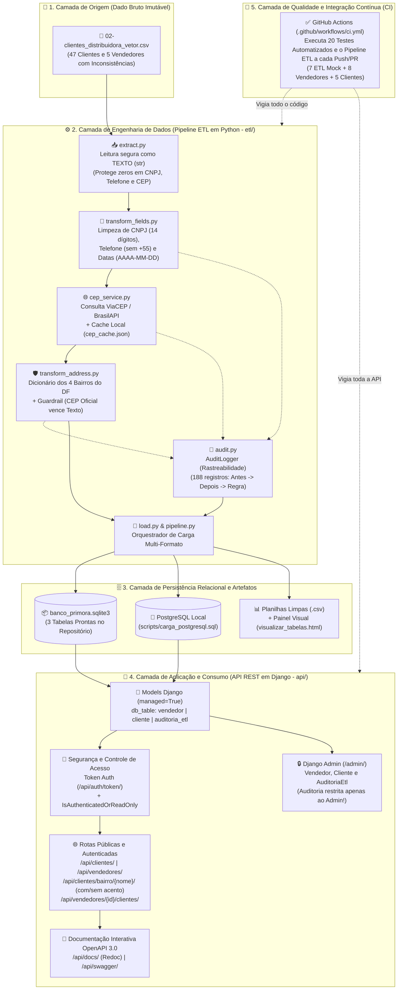

# 🏗️ Arquitetura Ponta a Ponta do Sistema — Desafio Primora (Distribuidora Vetor)

> **Visão Geral em Frases Simples:**  
> Este documento mostra como o nosso sistema funciona do começo ao fim: desde a leitura da planilha bruta dos 47 clientes, passando pelo motor de limpeza (ETL em Python) e pelo banco de dados relacional, até chegar na API REST em Django e no monitoramento automático de qualidade.

---

## 🗺️ 1. Diagrama Visual da Arquitetura Completa

---

## 🧩 2. Explicação das 5 Camadas da Arquitetura

### Camada 1: Origem dos Dados (`data/raw/`)
- Guarda o arquivo original `02-clientes_distribuidora_vetor.csv` **intocado**.
- Contém os problemas reais simulados pelo desafio: 20 grafias diferentes de bairros, CEPs vazios ou `00000-000`, 3 conflitos entre bairro e CEP, além de formatos mistos de CNPJ, telefone e datas.

### Camada 2: Pipeline ETL em Python (`etl/`)
Dividido em módulos independentes e acionado por um único comando (`python -m etl.pipeline`):
1. **Extração (`extract.py`):** Carrega todos os campos como texto (`str`) para nunca perder zeros à esquerda ou à direita.
2. **Transformação de Campos (`transform_fields.py`):** Padroniza CNPJ (14 dígitos), Telefone (10/11 dígitos sem `+55`) e Datas (`AAAA-MM-DD`).
3. **Enriquecimento de CEP (`cep_service.py`):** Consulta a API oficial dos Correios (**ViaCEP** com *fallback* para **BrasilAPI**) e salva as respostas no **Cache Local (`cep_cache.json`)**, garantindo execução instantânea e funcionamento mesmo sem internet.
4. **Padronização de Bairros e Guardrail (`transform_address.py`):** Une todas as variações nos **4 bairros canônicos do DF** (`Águas Claras`, `Taguatinga`, `Vicente Pires`, `Guará`) e aplica o **Guardrail de Conflito**: quando o CEP é válido na base oficial, o bairro do CEP prevalece sobre erros de digitação.
5. **Auditoria (`audit.py`):** Registra cada uma das **188 transformações** realizadas (`id_cliente`, `campo_afetado`, `valor_original`, `valor_tratado`, `regra_aplicada`).

### Camada 3: Persistência Relacional (`data/processed/` e `scripts/`)
As **3 tabelas relacionais** (`vendedor`, `cliente` e `auditoria_etl`) são entregues simultaneamente em:
- **Banco SQLite pronto (`banco_primora.sqlite3`):** Permite que a API funcione imediatamente após clonar o repositório.
- **Script Oficial PostgreSQL (`scripts/carga_postgresql.sql`):** Cria e popula as 3 tabelas em 1 segundo no PostgreSQL local.
- **Planilhas CSV e Painel Visual HTML (`visualizar_tabelas.html`):** Permite inspecionar os dados direto no navegador ou no Excel.

### Camada 4: API REST em Django (`api/`)
- **Conexão Híbrida (`settings.py`):** Conecta ao PostgreSQL se configurado no `.env`, ou usa automaticamente o `banco_primora.sqlite3` do ETL.
- **Endpoints de Negócio:** CRUD completo de Clientes e Vendedores + rotas de relacionamento por bairro (`/api/clientes/bairro/{nome}/` integrada ao normalizador do ETL) e por vendedor (`/api/clientes/vendedor/{id}/` e `/api/vendedores/{id}/clientes/`).
- **Segurança (`IsAuthenticatedOrReadOnly` + Token):** Visitantes não logados só podem consultar (`GET`); usuários autenticados via Token (`/api/auth/token/`) realizam alterações (`POST`, `PUT`, `PATCH`, `DELETE`).
- **Governança no Admin (`/admin/`):** As 3 tabelas estão registradas no Django Admin, sendo a tabela `auditoria_etl` **exclusiva do Admin** (não exposta na API pública).
- **Documentação Interativa (`drf-spectacular`):** Publicada em `/api/docs/` (Redoc) e `/api/swagger/` (Swagger UI).

### Camada 5: Qualidade e Integração Contínua — CI (`.github/workflows/ci.yml`)
- Nosso **Bot de Monitoramento no GitHub Actions (CI)** executa automaticamente os **20 testes automatizados** (7 do ETL com simulação *Mock* + 8 de Vendedores + 5 de Clientes) e roda o pipeline completo a cada *Push* ou *Pull Request*, deixando a base pronta para futura implantação contínua (CD).

---

## 🏆 3. Resumo das Principais Decisões Arquiteturais

| Decisão Técnica | Onde foi aplicada | Por que escolhemos assim? (Benefício) |
| :--- | :--- | :--- |
| **CNPJ, Telefone e CEP como `VARCHAR` (Texto)** | `etl/extract.py`, `etl/transform_fields.py`, `models.py` | Evita que o banco de dados ou o Excel apaguem zeros à esquerda (ex: CNPJ `04...`) ou à direita (ex: Telefone `...00`). |
| **Cache Local de CEP (`cep_cache.json`)** | `etl/cep_service.py` | Evita consultar o mesmo CEP várias vezes na internet, deixando o ETL instantâneo e resistente a quedas de rede. |
| **Guardrail: CEP Oficial Vence Texto** | `etl/transform_address.py` | Corrige erros humanos de digitação no cadastro (`CLI0002`, `CLI0017`, `CLI0033`) usando a base oficial dos Correios, registrando a troca na auditoria. |
| **Reuso do Normalizador do ETL na API** | `api/clientes/views.py` | Permite que a rota `/api/clientes/bairro/{nome}/` encontre clientes mesmo quando o usuário pesquisa sem acento (`aguas claras`, `guara ii`). |
| **Isolamento da Tabela `auditoria_etl`** | `api/clientes/admin.py` | Cumpre a regra de governança do desafio: os logs de auditoria ficam visíveis apenas para administradores no Django Admin. |
