# 🏗️ Arquitetura Ponta a Ponta do Sistema — Desafio Primora (Distribuidora Vetor)

Documento técnico de arquitetura do sistema integrado de **Engenharia de Dados (Pipeline ETL em Python)** e **Backend (API REST em Django / DRF)** desenvolvido para a Distribuidora Vetor.

---

## 🗺️ 1. Diagrama Interativo da Arquitetura (Mermaid)

O fluxo principal percorre as camadas de dados (**Origem → ETL Python → Persistência SQL → Aplicação Django/DRF → Consumidores**), enquanto a camada de **Qualidade e Integração Contínua (CI)** atua transversalmente validando o código.

```mermaid
flowchart TD
    subgraph C1["📂 1. Camada de Dados Brutos (Origem Imutável)"]
        RAW["📄 data/raw/02-clientes_distribuidora_vetor.csv<br/>47 clientes | 5 vendedores | 20 grafias de bairros<br/>CEPs ausentes/00000-000 | 3 conflitos CEP x Bairro"]
    end

    subgraph C2["⚙️ 2. Camada de Engenharia de Dados (Pipeline ETL Python - etl/)"]
        EXT["📥 extract.py<br/>Extração textual segura (str)<br/>Preserva zeros à esquerda/direita"]
        TF["🧹 transform_fields.py<br/>CNPJ (14 dígitos texto)<br/>Telefone (10/11 dígitos sem +55)<br/>Datas (ISO AAAA-MM-DD)"]
        CEP["🌐 cep_service.py<br/>Consulta ViaCEP (principal)<br/>Fallback automático BrasilAPI"]
        CACHE[("⚡ cep_cache.json<br/>Cache Local de CEPs")]
        TA["🛡️ transform_address.py<br/>Dicionário Canônico (4 bairros do DF)<br/>+ Guardrail de Conflito (CEP oficial vence texto)<br/>Corrigidos: CLI0002, CLI0017 e CLI0033"]
        AUD["📝 audit.py<br/>AuditLogger (188 registros)<br/>valor_original -> valor_tratado -> regra_aplicada"]
        LOAD["💾 load.py & pipeline.py<br/>Carga simultânea multi-formato"]
    end

    subgraph C3["🗄️ 3. Camada de Persistência Relacional e Artefatos"]
        T_VEND[("Tabela: vendedor<br/>PK: id_vendedor<br/>(5 registros)")]
        T_CLI[("Tabela: cliente<br/>PK: id_cliente | FK: vendedor_id<br/>(47 registros tratados)")]
        T_AUD[("Tabela: auditoria_etl<br/>PK: id_auditoria | FK: id_cliente<br/>(188 registros de tratamento)")]
        ARTEFATOS["📊 Artefatos Exportados<br/>banco_primora.sqlite3 | carga_postgresql.sql<br/>CSVs limpos | visualizar_tabelas.html"]
    end

    subgraph C4["🚀 4. Camada de Aplicação e Consumo (Django + DRF - api/)"]
        ORM["🧱 Models Django (managed=True)<br/>Mapeamento db_table: vendedor, cliente, auditoria_etl"]
        AUTH["🔐 Autenticação e Controle de Acesso<br/>Token Auth (/api/auth/token/)<br/>Permissão Global: IsAuthenticatedOrReadOnly"]
        API_ROTAS["🌐 Endpoints da API REST<br/>/api/clientes/ | /api/vendedores/<br/>/api/clientes/bairro/{nome}/<br/>/api/clientes/vendedor/{id}/<br/>/api/vendedores/{id}/clientes/"]
        ADMIN["🔒 Django Admin (/admin/)<br/>Gerencia Vendedor e Cliente<br/>Exibe auditoria_etl (Restrita ao Admin)"]
        OPENAPI["📖 Documentação OpenAPI 3.0 (drf-spectacular)<br/>/api/docs/ (Redoc) | /api/swagger/ (Swagger UI)"]
    end

    subgraph C_USERS["👥 Perfis de Consumo"]
        U_PUB["👤 Visitante Não Autenticado<br/>Apenas Leitura (GET)"]
        U_AUTH["🔑 Usuário Autenticado (Token)<br/>CRUD Completo (GET, POST, PUT, PATCH, DELETE)"]
        U_ADM["🛡️ Administrador<br/>Painel Django Admin + Auditoria"]
    end

    subgraph C5["🤖 5. Camada Transversal de Qualidade e Integração Contínua (CI)"]
        CI["✅ GitHub Actions (.github/workflows/ci.yml)<br/>Valida Push e Pull Requests automaticamente<br/>20 Testes (7 ETL Mock + 8 Vendedores + 5 Clientes) + Execução do Pipeline"]
    end

    RAW --> EXT
    EXT --> TF
    TF --> CEP
    CEP <--> CACHE
    CEP --> TA
    TF -.-> AUD
    CEP -.-> AUD
    TA -.-> AUD
    TA --> LOAD
    AUD --> LOAD

    LOAD --> T_VEND
    LOAD --> T_CLI
    LOAD --> T_AUD
    LOAD --> ARTEFATOS
    T_VEND --> T_CLI
    T_CLI --> T_AUD

    T_VEND --> ORM
    T_CLI --> ORM
    T_AUD --> ORM

    ORM --> AUTH
    AUTH --> API_ROTAS
    ORM --> ADMIN
    API_ROTAS --> OPENAPI

    API_ROTAS --> U_PUB
    API_ROTAS --> U_AUTH
    OPENAPI --> U_PUB
    ADMIN --> U_ADM

    CI -. "Testa e valida ETL (7 testes + pipeline)" .-> C2
    CI -. "Testa e valida API (13 testes DRF)" .-> C4
```



---

## 📐 2. Diagrama Estrutural em Blocos (ASCII)

```text
+-----------------------------------------------------------------------------------+
| 1. CAMADA DE DADOS BRUTOS (Imutável)                                              |
|    [ data/raw/02-clientes_distribuidora_vetor.csv ] -> 47 Clientes | 5 Vendedores |
+-----------------------------------------+-----------------------------------------+
                                          |
                                          v
+-----------------------------------------------------------------------------------+
| 2. CAMADA DE ENGENHARIA DE DADOS (Pipeline ETL em Python - pasta etl/)            |
|                                                                                   |
|  [extract.py] ---> Leitura 100% em TEXTO (str) para proteger zeros                |
|       |                                                                           |
|       v                                                                           |
|  [transform_fields.py] ---> CNPJ (14 dig) | Telefone (DDD+Num) | Data (AAAA-MM-DD)|
|       |                                                                           |
|       v                                                                           |
|  [cep_service.py] <---> [cep_cache.json] (ViaCEP principal / BrasilAPI fallback)  |
|       |                                                                           |
|       v                                                                           |
|  [transform_address.py] --> 4 Bairros Canônicos + Guardrail (CEP vence Texto)     |
|       |                     (Conflitos corrigidos: CLI0002, CLI0017 e CLI0033)   |
|       +-------------------> [audit.py] (Gera 188 registros de antes/depois/regra) |
|       |                                                                           |
|       v                                                                           |
|  [load.py / pipeline.py] -> Gera SQLite, Script PostgreSQL, CSVs e Painel HTML    |
+-----------------------------------------+-----------------------------------------+
                                          |
                                          v
+-----------------------------------------------------------------------------------+
| 3. CAMADA DE PERSISTÊNCIA RELACIONAL SQL (banco_primora.sqlite3 & PostgreSQL)     |
|                                                                                   |
|  +--------------------+      1:N      +--------------------+      1:N             |
|  | TABELA: vendedor   | ------------> | TABELA: cliente    | -----------+         |
|  | PK: id_vendedor    |               | PK: id_cliente     |            |         |
|  | (5 vendedores)     |               | FK: vendedor_id    |            v         |
|  +--------------------+               | (47 clientes)      |   +----------------+ |
|                                       +--------------------+   | auditoria_etl  | |
|                                                                | PK:id_auditoria| |
|                                                                | FK:id_cliente  | |
|                                                                | (188 registros)| |
|                                                                +----------------+ |
+-----------------------------------------+------------------------------+----------+
                                          |                              |
                                          v                              | (Exclusivo)
+--------------------------------------------------------------------+   |
| 4. CAMADA DE APLICAÇÃO E CONSUMO (Django + DRF - pasta api/)       |   |
|                                                                    |   v
|  * Rotas Públicas (GET) / Restritas por Token (POST/PUT/DELETE):   | +------------+
|    - /api/clientes/                  - /api/vendedores/            | | /admin/    |
|    - /api/clientes/bairro/{nome}/    - /api/vendedores/{id}/clientes| | Django     |
|    - /api/clientes/vendedor/{id}/    - /api/auth/token/            | | Admin      |
|  * Documentação Interativa OpenAPI:  - /api/docs/ e /api/swagger/  | +------------+
+--------------------------------------------------------------------+
                                          ^
                                          : (Validação Transversal em Push/PR)
+-----------------------------------------+-----------------------------------------+
| 5. CAMADA DE QUALIDADE E INTEGRAÇÃO CONTÍNUA - CI (.github/workflows/ci.yml)      |
|    GitHub Actions: Executa 20 testes automatizados (7 ETL + 8 Vend + 5 Cli)       |
+-----------------------------------------------------------------------------------+
```

---

## 🧩 3. Especificação Executiva das 5 Camadas

### Camada 1 — Dados Brutos (`data/raw/`)
- **Função:** Preservar a evidência original fornecida pela empresa sem qualquer alteração direta (*imutabilidade do dado bruto*).
- **Entrada:** Arquivo `02-clientes_distribuidora_vetor.csv` com 47 registros de clientes e 5 vendedores.
- **Resultado:** Base de origem auditável contendo as inconsistências reais do desafio (20 grafias de bairros, CEPs vazios ou `00000-000`, 3 conflitos entre bairro e CEP, máscaras mistas de CNPJ/telefone e datas em múltiplos idiomas).

### Camada 2 — Engenharia de Dados / Pipeline ETL (`etl/`)
- **Função:** Extrair, limpar, padronizar, enriquecer geograficamente via API de CEP e auditar cada modificação realizada.
- **Entrada:** Os 47 registros brutos lidos como texto (`str`) pelo módulo `extract.py`.
- **Resultado:**
  - Campos padronizados (`cnpj_normalizado` com 14 dígitos, `telefone_normalizado` com 10/11 dígitos sem `+55`, `data_cadastro_normalizado` em `AAAA-MM-DD`).
  - Bairros consolidados nos **4 nomes canônicos do DF** (`Águas Claras`: 21, `Taguatinga`: 13, `Vicente Pires`: 6, `Guará`: 6) e `Não Informado`: 1 (`CLI0047`).
  - **3 conflitos reais (`CLI0002`, `CLI0017`, `CLI0033`)** corrigidos pelo Guardrail de CEP oficial e **188 registros de auditoria** gerados.

### Camada 3 — Persistência Relacional SQL (`data/processed/` e `scripts/`)
- **Função:** Garantir integridade relacional, chaves primárias/estrangeiras e disponibilidade imediata para a aplicação web e análises.
- **Entrada:** Tabelas em memória processadas pelo orquestrador `etl/pipeline.py`.
- **Resultado:** 3 tabelas relacionais (`vendedor`, `cliente`, `auditoria_etl`) persistidas em banco SQLite (`banco_primora.sqlite3`), script SQL transacional para PostgreSQL (`scripts/carga_postgresql.sql`), planilhas CSV limpas e painel visual HTML (`visualizar_tabelas.html`).

### Camada 4 — Aplicação e Consumo via API REST (`api/`)
- **Função:** Disponibilizar consultas públicas, operações de manutenção autenticadas (CRUD), administração segura e documentação interativa.
- **Entrada:** Conexão direta às tabelas do ETL via Django ORM (`db_table`) e requisições HTTP dos usuários.
- **Resultado:**
  - Endpoints RESTful completos (`/api/clientes/`, `/api/vendedores/` e rotas de relacionamento por bairro e vendedor).
  - Autenticação via Token (`/api/auth/token/`) e controle de acesso `IsAuthenticatedOrReadOnly`.
  - Tabela `auditoria_etl` isolada exclusivamente no Django Admin (`/admin/`).
  - Documentação OpenAPI 3.0 gerada com `drf-spectacular` em `/api/docs/` (Redoc) e `/api/swagger/` (Swagger UI).

### Camada 5 — Qualidade e Integração Contínua / CI (`.github/workflows/ci.yml`)
- **Função:** Impedir regressões e validar automaticamente tanto o pipeline de dados quanto a API REST a cada alteração enviada ao repositório.
- **Entrada:** Eventos de `push` e `pull_request` monitorados pelo GitHub Actions.
- **Resultado:** Execução automatizada de **20 testes** (**7 de ETL** com simulação *Mock* da API de CEP + **8 de Vendedores** + **5 de Clientes**) e validação da execução completa do pipeline ETL, compondo uma estrutura sólida de **Integração Contínua (CI)** pronta para evoluir a **CI/CD**.

---

## 🏆 4. Matriz de Decisões Arquiteturais

| Decisão Arquitetural | Problema Resolvido | Justificativa Técnica | Benefício Direto |
| :--- | :--- | :--- | :--- |
| **Cache Local de CEP (`cep_cache.json`) com ViaCEP + Fallback BrasilAPI** | Lentidão em chamadas HTTP repetidas e risco de indisponibilidade de rede ou queda de API externa. | Consultar a internet para o mesmo CEP repetidamente degrada o tempo de resposta e cria ponto único de falha. | Execução em milissegundos nas leituras em cache, tolerância a falhas com duas APIs públicas gratuitas e operação *offline*. |
| **Guardrail de Conflito: CEP Validado Vence Texto Digitado** | Divergência entre o bairro digitado livremente pelo vendedor e o CEP real cadastrado (`CLI0002`, `CLI0017`, `CLI0033`). | O código postal validado pela consulta externa de referência geográfica é determinístico e auditável, superior ao texto livre sujeito a erro humano. | Elimina distorções nos relatórios regionais e mantém transparência total ao gravar a substituição em `auditoria_etl`. |
| **CNPJ, Telefone e CEP como Texto (`VARCHAR` / `str`)** | Perda de zeros à esquerda (ex: CNPJ `04...` em `CLI0031`) ou à direita (ex: Telefone `...00` em `CLI0001`) quando tratados como tipos numéricos. | Identificadores cadastrais não sofrem operações aritméticas; tipos inteiros removem zeros significativos. | Preservação de 100% dos dígitos originais tanto no banco SQL quanto nas exportações CSV e JSON. |
| **Reuso do Normalizador do ETL na Rota da API (`/api/clientes/bairro/{nome}/`)** | Usuários da API podem buscar bairros sem acentuação ou com grafias variadas na URL (ex: `aguas claras`, `guara ii`). | Acoplar a função `canonicalize_neighborhood_name` do ETL na `ClienteViewSet` unifica a regra de negócio entre engenharia de dados e backend. | Experiência de busca flexível e consistente, retornando os clientes corretos independentemente de acentos ou caixa. |
| **Isolamento de `auditoria_etl` no Django Admin** | Necessidade de auditar transformações sem expor histórico bruto de correções na API pública. | Cumpre o requisito de governança do projeto registrando o model `AuditoriaEtl` apenas em `admin.py` com campos `readonly_fields`. | Segurança da informação e rastreabilidade administrativa completa em `/admin/`. |
| **Integração Contínua (CI) no GitHub Actions** | Risco de que edições paralelas da equipe quebrem regras do ETL ou rotas da API antes do *merge*. | Um workflow automatizado executando os 20 testes e o pipeline a cada Push/PR garante qualidade contínua sem intervenção manual. | Confiabilidade comprovada por selo verde no repositório e base pronta para futura implantação contínua (CD). |
