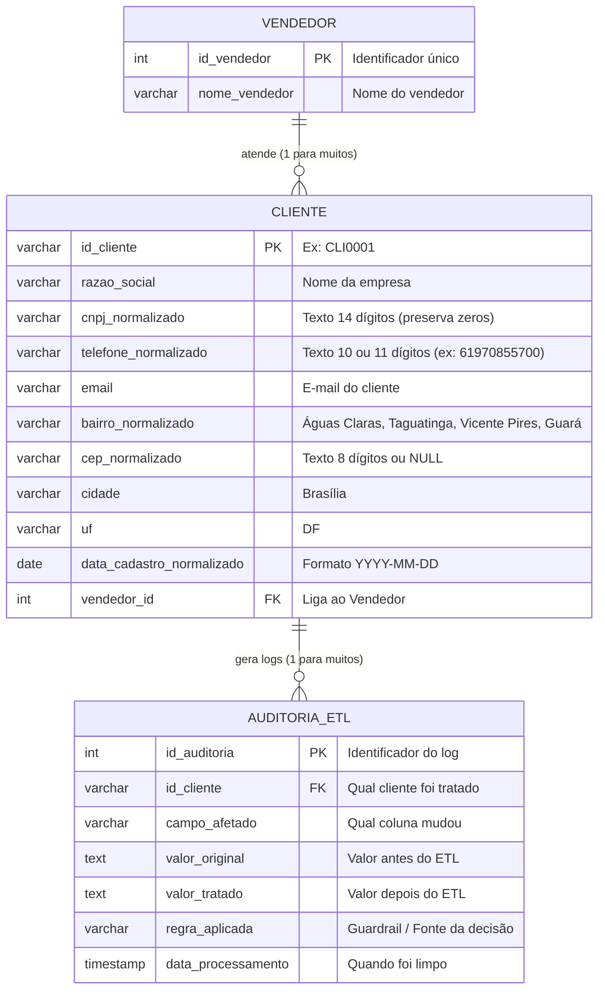

# 🗄️ Modelagem de Dados (MER e DER) — Desafio Primora

> **Explicação simples:**  
> - **MER (Modelo Entidade-Relacionamento):** É a descrição em texto de quais tabelas existem e o que vai em cada coluna.  
> - **DER (Diagrama Entidade-Relacionamento):** É o desenho visual mostrando como as tabelas se conectam.

---

## 1. MER — Estrutura das 3 Tabelas do Banco

Seguindo os PDFs do desafio, nosso banco de dados terá **3 tabelas**:

### Tabela 1: `vendedor`
Guarda a lista única dos vendedores responsáveis, evitando repetir nomes várias vezes.
- `id_vendedor` (**PK** - Chave Primária, número sequencial único)
- `nome_vendedor` (**VARCHAR(100)**, texto obrigatório e único)

### Tabela 2: `cliente`
Guarda os dados finais dos clientes já limpos, validados e padronizados pelo ETL.
- `id_cliente` (**VARCHAR(20)**, código único do cliente, ex: `"CLI0001"`)
- `razao_social` (**VARCHAR(150)**, nome da empresa cliente)
- `cnpj_normalizado` (**VARCHAR(14)**, **TEXTO** com os 14 números sem pontuação, para nunca perder zeros)
- `telefone_normalizado` (**VARCHAR(11)**, **TEXTO** apenas com DDD + número, ex: `"61970855700"`)
- `email` (**VARCHAR(150)**, e-mail de contato)
- `bairro_normalizado` (**VARCHAR(100)**, um dos 4 bairros oficiais ou `"Não Informado"`)
- `cep_normalizado` (**VARCHAR(8)**, **TEXTO** com os 8 dígitos do CEP válido ou `NULL` se ausente/inválido)
- `cidade` (**VARCHAR(50)**, sempre `"Brasília"`)
- `uf` (**VARCHAR(2)**, sempre `"DF"`)
- `data_cadastro_normalizado` (**DATE**, data no formato universal `AAAA-MM-DD`)
- `vendedor_id` (**FK** - Chave Estrangeira que aponta para a tabela `vendedor`)

### Tabela 3: `auditoria_etl`
Guarda o histórico de todas as correções feitas pelo ETL (visível apenas na administração do banco/sistema).
- `id_auditoria` (**PK** - Chave Primária, número sequencial)
- `id_cliente` (**VARCHAR(20)**, qual cliente sofreu a correção)
- `campo_afetado` (**VARCHAR(50)**, ex: `"bairro"`, `"cep"`, `"cnpj"`, `"telefone"`, `"data_cadastro"`)
- `valor_original` (**TEXT**, como o dado veio sujo do CSV)
- `valor_tratado` (**TEXT**, como o dado ficou após a limpeza)
- `regra_aplicada` (**VARCHAR(100)**, qual guardrail ou regra justificou a mudança)
- `data_processamento` (**TIMESTAMP**, data e hora em que o ETL rodou)

---

## 2. DER — Desenho das Tabelas e Relacionamentos

---

## 3. Como as Tabelas Conversam? (Relacionamentos)
1. **Um Vendedor para Muitos Clientes (`1:N`):**  
   Um único vendedor (ex: `Camila Torres`) atende vários clientes, mas cada cliente tem apenas 1 vendedor responsável.
2. **Um Cliente para Muitos Registros de Auditoria (`1:N`):**  
   Um único cliente (ex: `CLI0002`) pode ter tido o telefone limpo, a data ajustada e o bairro corrigido pelo CEP — gerando várias linhas no histórico de auditoria.

